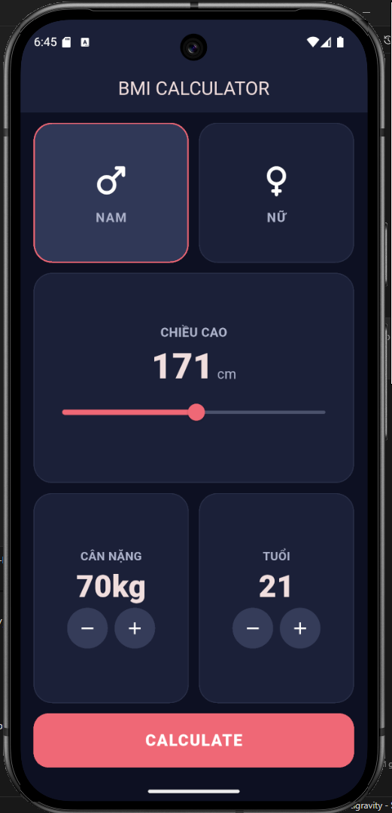
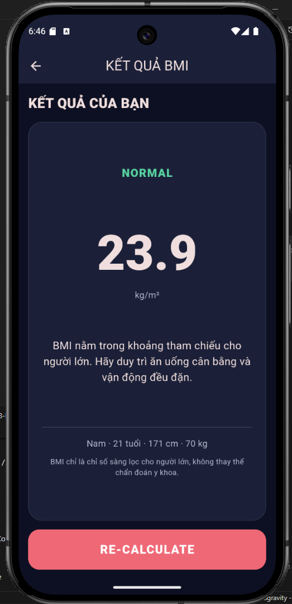

# Flutter Lab 08 — BMI Calculator

Ứng dụng Flutter tính BMI cho người lớn từ chiều cao và cân nặng, hiển thị phân loại và lời giải thích ngắn trên màn hình kết quả.

## Chức năng

- Chọn giới tính Nam/Nữ, chỉnh chiều cao 120–220 cm bằng slider.
- Tăng/giảm cân nặng 20–300 kg và tuổi 18–100 bằng các nút tròn.
- Nhấn **CALCULATE** để mở `ResultsPage`; nhấn **RE-CALCULATE** để quay lại với dữ liệu đã nhập.
- `CalculatorBrain` dùng công thức `BMI = cân nặng (kg) / [chiều cao (m)]²`, hiển thị một chữ số thập phân.
- Phân loại cho người lớn: Underweight (<18,5), Normal (18,5–<25), Overweight (25–<30), Obesity (≥30).

Mã được chia thành `components/`, `screens/`, `constants.dart` và `calculator_brain.dart`. Các widget `ReuseableCard`, `BottomButton`, `IconContent`, `RoundIconButton` được tái sử dụng.

## Ảnh ứng dụng

| Màn hình nhập liệu | Màn hình kết quả |
| --- | --- |
|  |  |

## Lưu ý

BMI là chỉ số sàng lọc, không phải chẩn đoán. Ứng dụng giới hạn tuổi từ 18 trở lên; giới tính và tuổi không tham gia công thức BMI cho người lớn.

Tham khảo: [WHO — phân loại BMI người lớn](https://www.who.int/europe/news-room/fact-sheets/item/nutrition---maintaining-a-healthy-lifestyle), [CDC — BMI chỉ là chỉ số sàng lọc](https://www.cdc.gov/bmi/adult-calculator/index.html).

## Chạy và kiểm tra

```bash
flutter pub get
flutter run
flutter analyze
flutter test
```

Chọn thiết bị Android hoặc trình giả lập trước khi chạy. Dự án chỉ tạo nền tảng Android.
